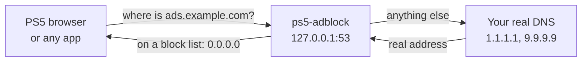

# ps5-adblock

**A network-wide ad blocker that lives inside your jailbroken PS5.**

[](https://github.com/manuumv/adblock-ps5/actions/workflows/build.yml)
[](LICENSE)

ps5-adblock is a small payload that turns the console into its own ad-blocking DNS server, in the style of Pi-hole. It blocks ads, pop-up ad tabs and trackers in the PS5 web browser, and anything else on the console that asks for a blocked domain. It runs entirely on the PS5: once it is installed you need no computer, no router changes and no app.

> **Status: early.** Blocking, self-updating lists, the allowlist, live reloads and optional autostart all work. Expect rough edges, and please report what you find.

---

## Contents

- [Features](#features)
- [How it works](#how-it-works)
- [What it can and cannot block](#what-it-can-and-cannot-block)
- [Requirements](#requirements)
- [Quick start](#quick-start)
- [Installation in detail](#installation-in-detail)
- [Notifications](#notifications)
- [Block lists](#block-lists)
- [Configuration](#configuration)
- [Troubleshooting](#troubleshooting)
- [Uninstall](#uninstall)
- [For developers](#for-developers)
- [Credits](#credits)
- [License](#license)

---

## Features

- 🛡️ **Blocks ads and pop-up ad tabs** in the PS5 browser using well-known community block lists ([HaGeZi](https://github.com/hagezi/dns-blocklists)), about 200,000 domains out of the box.
- 🔄 **Lists keep themselves up to date.** They are downloaded over verified HTTPS when the payload first starts and checked again every 24 hours.
- ⚡ **Fast and light.** Handles lists of over a million domains with about 8 bytes of memory per domain, and answers in microseconds.
- ✅ **Allowlist.** If a site breaks, add its domain and it is never blocked again.
- ♻️ **Live reload.** Edit lists or the allowlist and changes apply within 30 seconds, with no restart.
- 🚀 **Optional autostart** with etaHEN or onionHEN. It also works with any plain ELF loader.
- 🔔 **Clear notifications** on the console, so you always know whether blocking is on.
- 🧱 **Blocks firmware updates and PSN by default**, so the console cannot update itself out of its jailbreak.
- 🔒 **Careful by design.** It only answers devices on your local network and never downloads over plain HTTP. It resolves its own download servers directly, so a list can never block its own updates.

## How it works

Every time something on the console opens a web address, it first asks a DNS server for that address's IP. ps5-adblock becomes that DNS server.



- **Blocked domains** get the answer `0.0.0.0`, an address that leads nowhere, so the ad never loads.
- **Every other domain** is passed to a real DNS server (Cloudflare and Quad9 by default) and the answer comes back unchanged.

## What it can and cannot block

DNS blocking works on whole domains. It is very effective against ad networks but cannot see inside a page.

| ✅ Blocks | ❌ Cannot block |
|---|---|
| Ads served by ad networks (Google Ads, DoubleClick, Taboola, …) | Ads served from the same domain as the content, such as YouTube video ads |
| Scripts that open pop-up and pop-under ad tabs | A new tab the site opens itself. The tab still opens, but shows an error page instead of the ad |
| Trackers and analytics | The empty space where a blocked ad used to be |
| Firmware update servers (on by default, see [Firmware updates](#firmware-updates)) | Promotions on the PS5 home screen that come from Sony's own content servers |

## Requirements

- **A jailbroken PS5** with an ELF loader listening on port **9021**. Most jailbreak chains include one.
- **etaHEN or onionHEN is optional.** With one, ps5-adblock starts by itself after every reboot. Without one, you send it from your loader after each reboot.
- **The console's date and time must be correct.** Lists are downloaded over HTTPS, and a wrong clock makes every certificate look invalid.

## Quick start

1. **Get the payload.** Download `ps5-adblock.elf` from the [Releases](https://github.com/manuumv/adblock-ps5/releases) page, or [build it yourself](#build).
2. **Send it to the console** with your loader on port 9021. From a computer, for example:
   ```sh
   nc -w 1 <ps5-ip> 9021 < ps5-adblock.elf
   ```
3. **Keep your network settings as they are.** While it runs, ps5-adblock points the console's DNS at itself, and the console gets its own DNS back when the payload stops or the console reboots. See [The console's DNS](#the-consoles-dns).

That's it. You will see **"DNS 127.0.0.1 ready, downloading block lists"**. About half a minute later you will see **"blocking 199603 domains and firmware updates"**, and ads are gone.

## Installation in detail

### Option A: start automatically with etaHEN or onionHEN (recommended)

Both HENs run any `payloads/<name>.elf` that has an empty `<name>.elf.auto_start` file next to it. Set it up once:

**With an FTP app on your phone or computer:**

1. Connect to the HEN's FTP server: etaHEN on port **2121**, onionHEN on port **1337**.
2. Upload `ps5-adblock.elf` to `/data/etaHEN/payloads/` (onionHEN: `/data/OnionHEN/payloads/`).
3. Create an empty file next to it named `ps5-adblock.elf.auto_start`.
4. Send the payload once to port 9021, or reboot and jailbreak.

**Or from a computer with this repository:**

```sh
make install PS5_HOST=<ps5-ip>                                                         # etaHEN
make install PS5_HOST=<ps5-ip> PS5_FTP=ftp://<ps5-ip>:1337 PS5_HEN_DIR=/data/OnionHEN  # onionHEN
```

Every time it starts, ps5-adblock copies itself into the other HEN's folder too, so switching HENs keeps it running. It also refreshes a `pldmgr` copy if you have one.

### Option B: no HEN

Send `ps5-adblock.elf` to your loader on port 9021 after each reboot. Nothing else is needed. Sending it again while it runs replaces the running copy, which is also how you update it.

### The console's DNS

Every lookup has to reach ps5-adblock for it to block anything. You do not need to change the network settings for that: once the payload is running, it points the console's DNS at itself (`127.0.0.1`), without touching the settings.

- **Before the jailbreak**, the console uses the DNS from its network settings, so a jailbreak that needs the internet keeps working.
- **While ps5-adblock runs**, every lookup goes through it. If the network reconnects, it takes the DNS over again within a minute.
- **When it stops, or the console reboots**, the console is back on the DNS from its settings.

`dns_redirect=0` in `[general]` turns this off.

**Recommended: a DNS that blocks Sony in the network settings.** Before the jailbreak ps5-adblock is not running yet, so nothing stops a firmware update except the console's own DNS. Some public DNS servers refuse Sony's update and PSN servers: put one in **Settings › Network › Settings › Set Up Internet Connection ›** your connection **› Advanced Settings › DNS Settings › Manual**, and list it in `config.ini` too, so ps5-adblock passes lookups on to it:

```ini
[upstream]
server=<your Sony-blocking DNS>
```

**If you see *no lookup reached the blocker*,** this console did not accept the redirect. Set **Primary DNS** to `127.0.0.1` and leave **Secondary DNS** empty instead. Then the console has no internet before ps5-adblock runs, and so cannot update either. Please report it, with `/data/ps5-adblock/last.log`.

## Notifications

ps5-adblock talks to you through the console's notifications.

| Notification | Meaning |
|---|---|
| `DNS 127.0.0.1 ready, downloading block lists` | First start. DNS works and the lists are on their way. |
| `blocking N domains and firmware updates, DNS 127.0.0.1` | The lists are loaded and firmware updates are blocked. Shown once per start. Without *and firmware updates*, `block_updates=0` is set. |
| `no lookup reached the blocker after redirecting the console's DNS` | This console did not accept the DNS redirect. Set the DNS by hand, see [The console's DNS](#the-consoles-dns). |
| `nothing is blocked, the console's Primary DNS is …` | Only with `dns_redirect=0`, or when the redirect failed: the console is not asking ps5-adblock. Set **Primary DNS** to `127.0.0.1`. Checked every minute. |
| `Secondary DNS … lets lookups skip the blocker` | Same cases: leave **Secondary DNS** empty, or list it in `[upstream]` if it is a DNS that blocks Sony. |
| `DNS is set, blocking is on` | The DNS settings were fixed while ps5-adblock was running. |
| `cannot update list <name>: …` | A list could not be downloaded. The previous copy keeps working, and it retries in 5 minutes. Shown once until the list works again. |
| `… Check the console date and time.` | Added to the message above when the console clock looks wrong. |
| `cannot open DNS port 53 …` | Something else is using the DNS port, usually another DNS payload such as nanoDNS. |
| `an older copy is still running and did not stop` | Reboot the console and send the payload again. |
| `running, but it will not start by itself after a reboot` | A HEN is installed but the payload is not in its folder yet. See [Option A](#option-a-start-automatically-with-etahen-or-onionhen-recommended). |

Set `quiet=1` in the configuration to hide the start notifications. Errors are always shown.

## Block lists

Blocked domains come from every `.txt` file in `/data/ps5-adblock/lists/`. Each domain blocks all of its subdomains too: `ads.example.com` also blocks `x.ads.example.com`.

### Default lists

A new configuration comes with two lists chosen for the PS5 browser:

| Name | Domains | What it blocks |
|---|---|---|
| `hagezi-pro` | ~200,000 | Ads, trackers, malware and scam domains, with few false positives |
| `hagezi-popupads` | ~46,000 | Pop-up and pop-under ad networks, the source of most unwanted tabs |

They are downloaded about 15 seconds after the first start and checked again every 24 hours. Unchanged lists are not downloaded again, and a failed download always keeps the previous copy.

### Adding your own lists

Add a line to the `[lists]` section of `config.ini`:

```ini
[lists]
url=my-list|https://example.org/blocklist.txt
```

The name may use `a-z`, `0-9`, `-` and `_`. The list is saved as `lists/my-list.txt`. Only `https://` addresses are accepted, and up to 16 lists.

You can also copy any list file into `lists/` over FTP yourself. ps5-adblock picks it up within 30 seconds.

### Supported formats

```text
# hosts file entries
0.0.0.0 ads.example.com

# one domain per line
tracker.example.net

# Adblock-style domain rules
||popups.example.org^
```

Lines starting with `#` or `!` are comments. Adblock rules that only make sense inside a browser, such as element hiding (`##`), `$third-party`, paths and regexes, are skipped.

### Allowlist

If a site or feature breaks, put its domain in `/data/ps5-adblock/allowlist.txt`, in any of the formats above. Allowlisted domains and their subdomains are never blocked, whatever the lists say.

### Firmware updates

A firmware update removes the jailbreak, and Sony does not let you go back. So ps5-adblock blocks updates out of the box.

> ⚠️ Updates come from the same servers as PSN. ps5-adblock blocks every name under `playstation.com`, `playstation.net` and `psndl.net`, so **PSN features such as the store, game downloads and online play do not work** while it runs, and the console's network test reports that it cannot connect to PSN. That is expected.

Unlike nanoDNS, it lets no Sony host through. nanoDNS keeps a few reachable (`feature.api.playstation.com`, STUN, `ena.net`, `post.net` and `gst.prod.dl.playstation.net`) so the network test passes, and through them the console still shows itself as connected to PSN.

To use PSN, set `block_updates=0` in the `[blocking]` section and send the payload again. The console may then download and offer a firmware update, so turn off **Settings › System › System Software › System Software Update and Settings › Download Update Files Automatically** first, and never accept the update.

## Configuration

Settings live in `/data/ps5-adblock/config.ini`, which is created with sensible defaults on the first start. See [`config.ini.example`](config.ini.example) for a commented copy.

- Lines starting with `#` or `;` are comments.
- An invalid line is skipped and noted in `last.log` with its line number. The rest of the file still applies.
- Changes take effect the next time the payload starts.

| Section | Key | Default | Meaning |
|---|---|---|---|
| `[general]` | `debug` | `0` | `1` logs every query |
| | `quiet` | `0` | `1` hides the start notifications. Errors are always shown |
| | `dns_redirect` | `1` | Point the console's DNS at ps5-adblock while it runs, without changing the network settings (see [The console's DNS](#the-consoles-dns)) |
| | `autostart` | `1` | Keep the payload in every HEN's autostart folder. `0` removes it from autostart |
| | `bind` | `127.0.0.1` | IPv4 address to listen on. `0.0.0.0` serves your whole local network. Only private and link-local clients are ever answered |
| | `bind6` | `::1` | IPv6 address to listen on, or `off` |
| `[upstream]` | `server` | `1.1.1.1`, `9.9.9.9` | Real DNS servers, tried in order (up to 8). Listing any replaces the defaults |
| | `timeout_ms` | `1500` | Total time allowed for one lookup (100–30000), split evenly between the servers |
| `[blocking]` | `block_mode` | `null` | `null` answers `0.0.0.0` / `::`. `nxdomain` answers "no such domain" |
| | `max_domains` | `1500000` | Most domains loaded from `lists/` (1000–10000000) |
| | `block_updates` | `1` | Block firmware updates and PSN (see [Firmware updates](#firmware-updates)). `0` allows them. Applies even to a `config.ini` that does not list it |
| `[lists]` | `url` | the two HaGeZi lists | `<name>\|<https url>`. Up to 16. A config without `[lists]` downloads nothing |
| | `update_hours` | `24` | Hours between checks (0–720). `0` turns downloads off |
| `[overrides]` | `mask=IPv4` | | Answer matching names with this address, like a hosts file. Up to 256 |
| `[exceptions]` | `mask` | | Names that skip the overrides and always go to the real DNS. Up to 256 |

Masks are case-insensitive and accept `*`, `?`, `[abc]`, `[a-z]` and `[!0-9]`. `*.example.com` matches the subdomains of `example.com` but not `example.com` itself.

```ini
[overrides]
*.doubleclick.net=0.0.0.0
nas.home=192.168.1.10

[exceptions]
*.example.org
```

## Troubleshooting

**Nothing is blocked.**
The console's lookups are not reaching ps5-adblock, which also shows up as the *no lookup reached the blocker* or *nothing is blocked* notification. Set **Primary DNS** to `127.0.0.1` and leave **Secondary DNS** empty, see [The console's DNS](#the-consoles-dns). Within a minute you get *DNS is set, blocking is on*. Pages you had already opened may need a reload.

**An ad-block test page gives a low score.**
Test pages such as [adblock.turtlecute.org](https://adblock.turtlecute.org/) check three things, and DNS blocking can only pass one of them:
- **Hosts:** requests to real ad and tracker domains. ps5-adblock passes these: 126 of its 128 with the default lists. `ad.doubleclick.net` and `adservice.google.com` are left out of HaGeZi Pro on purpose, because blocking them breaks shopping links.
- **Script loading and cosmetic filtering:** decoy files and ad boxes served from the test site itself. Only an in-browser ad blocker can stop these, so they always show as *not blocked*.

**The console has no internet.**
If you set **Primary DNS** to `127.0.0.1` by hand, ps5-adblock is not running, usually because the console has just rebooted: send the payload again. If ps5-adblock stopped unexpectedly while redirecting the DNS, reconnect the network or reboot to get the DNS from your settings back.

**"cannot open DNS port 53".**
Another DNS payload (for example nanoDNS) is already running. Stop it or remove it from the HEN's autostart, then send ps5-adblock again.

**A site or feature stopped working.**
Add the domain it needs to `allowlist.txt` (see [Allowlist](#allowlist)). The change applies within 30 seconds.

**"cannot update list … Check the console date and time".**
The console clock is wrong, so HTTPS certificates look invalid. Fix the date and time; the next retry, within 5 minutes, will succeed.

**A setting seems to be ignored.**
Look in `/data/ps5-adblock/last.log` for `config line N:`, which explains why that line was skipped.

**I want to see what is happening.**
The log of the current session is written to `/data/ps5-adblock/last.log`, and the previous session's to `last.previous.log`. Grab them over FTP. Set `debug=1` to log every query as well.

## Uninstall

1. Set `autostart=0` in `/data/ps5-adblock/config.ini` and send the payload once. This removes it from the HEN's autostart. Alternatively, delete `ps5-adblock.elf*` from the HEN `payloads/` folders over FTP.
2. If you set **Primary DNS** to `127.0.0.1` by hand, set your DNS back in the network settings.
3. Optionally, delete `/data/ps5-adblock/`, which holds your configuration, lists and logs.

---

## For developers

### Build

```sh
tools/ps5-build.sh       # PS5 payload, built in Docker   -> build/ps5/ps5-adblock.elf
make ps5                 # the same with the SDK installed locally (PS5_PAYLOAD_SDK)
make deploy PS5_HOST=<ps5-ip>   # send it to the loader on port 9021
```

Building for the PS5 needs Docker, or the [ps5-payload-sdk](https://github.com/ps5-payload-dev/sdk) with LLVM 18 and the pacbrew libraries (static libcurl and OpenSSL).

### Run and test on a computer

Every module also builds for macOS and Linux, so most development happens without a console:

```sh
make host
ADBLOCK_DATA=./data ./build/host/ps5-adblock     # listens on 127.0.0.1:5300 and [::1]:5300
dig @127.0.0.1 -p 5300 pagead2.googlesyndication.com

make test                # all tests, with AddressSanitizer and UndefinedBehaviorSanitizer
make fuzz FUZZ=dns       # libFuzzer on the DNS parser, or FUZZ=listparse (needs clang with libFuzzer)
make bench               # blocklist benchmark (run `make fixtures` first)
```

`ADBLOCK_PORT` changes the port. Host builds need libcurl, and the tests need python3 and openssl.

### Source layout

```text
src/
├── main.c      startup: wires the modules together and runs the loop
├── core/       config.ini parsing, in-memory log, platform interface (platform.h)
├── dns/        wire format (dns.c), upstream forwarding (forward.c), server loop and decisions (server.c)
├── blocking/   blocklists (blocklist.c), list file formats (listparse.c), masks (rules.c), presets
├── console/    single instance, HEN autostart, notifications, log persistence (runtime.c)
└── updates/    scheduled list downloads (updater.c) over verified HTTPS (http.c, libcurl)
platform/
├── ps5/        platform.h on the console, SDK make rules, Docker image
└── host/       platform.h for macOS/Linux development
tests/          one folder per src/ module: test_*.c, fuzz_*.c, bench_*.c
```

Only `platform/ps5/platform.c` includes console headers, which is what keeps every other module testable on a computer.

## Credits

- [nanoDNS](https://github.com/drakmor/nanoDNS) by Drakmor: the DNS proxy and console integration this project grew from.
- [ps5-payload-sdk](https://github.com/ps5-payload-dev/sdk) by John Törnblom.

## License

GPLv3, see [LICENSE](LICENSE).

ps5-adblock is not affiliated with or endorsed by Sony Interactive Entertainment. Use it at your own risk.
